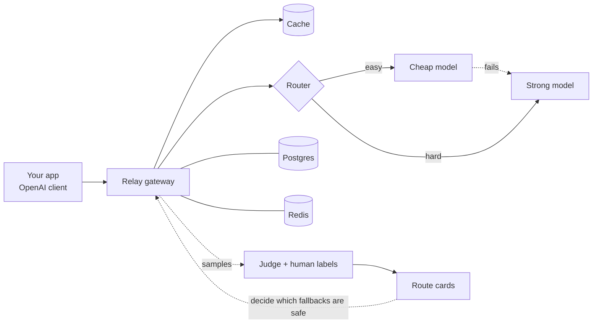

# Relay

An OpenAI-compatible LLM gateway you run yourself. It keeps apps up when model providers fail, cuts spend by sending easy requests to cheap models, and makes routing and fallback decisions from measured evidence.

## Quickstart

You need Docker. No API keys are needed to try it: out of the box Relay serves built-in simulator models.

```sh
git clone https://github.com/Anvayt24/Relay.git
cd Relay
```

```sh quickstart
docker compose up -d --build --wait
KEY=$(docker compose logs api | grep -o 'rk_[A-Za-z0-9_-]*' | head -1)
curl -s http://localhost:8000/v1/chat/completions \
  -H "Authorization: Bearer $KEY" -H "Content-Type: application/json" \
  -d '{"model": "relay/cheap", "messages": [{"role": "user", "content": "Say hello."}]}'
```

On its first start Relay generates its own secrets and prints one API key, once, in its logs (`docker compose logs api`). Any OpenAI client works by pointing `base_url` at `http://localhost:8000/v1`.

To use real models, copy `.env.example` to `.env`, add a provider key (`GROQ_API_KEY`, `ANTHROPIC_API_KEY`, ...) and run `docker compose up -d` again. For dashboards and traces, add `--profile observability`.

More in [guide/self-hosting.md](guide/self-hosting.md) (running it, upgrading, backups, scaling) and [guide/configuration.md](guide/configuration.md) (models, prices, routes, tenants, limits).

## How it works



A request is authenticated, limited, looked up in the cache, routed to a model, and charged against a budget it reserved up front. If the model fails, Relay retries once and then falls back, but only along fallbacks that are known to be as good. A share of traffic is judged in the background, so Relay measures its own cheap-model and fallback decisions instead of assuming them. The full design is in [guide/design.md](guide/design.md), and what happens when each part fails is in [guide/failure-modes.md](guide/failure-modes.md).

The gateway also serves a small demo page at `/` (a playground that shows what Relay decided and why, a chaos panel on a simulated provider, and the evidence view). With your API key it works on any deployment.

## Results

Every number comes from a command in this repository. `make reproduce` regenerates the evaluation numbers from frozen data and fails if any changed; [guide/results.md](guide/results.md) reports how the current system performs (fault tolerance, overhead, cache, router, evidence engine, judge) and how to reproduce each number. They are simulator and public-data results unless a line says otherwise.

## Development

Prerequisites: [uv](https://docs.astral.sh/uv/), GNU make, and Docker.

```sh
uv sync          # create .venv and install the exact versions pinned in uv.lock
make check       # lint + type-check + tests + evaluation gates
make up          # the dev stack: gateway, Postgres, Redis, Prometheus, Grafana, Tempo
make down
make smoke       # an end-to-end check of the self-hosted stack, with no provider keys
```

| Service in `make up` | URL |
|---|---|
| Relay API | http://localhost:8000 |
| Prometheus | http://localhost:9090 |
| Grafana | http://localhost:3000 |

## Repository map

| Path | What lives there |
|---|---|
| `relay/` | The gateway. Each subpackage's `__init__.py` says what it owns |
| `tests/` | pytest suite (`make test`) |
| `bench/` | Provider simulator, chaos, and load tests |
| `evals/` | Router, cache, evidence and judge evaluations |
| `deploy/` | docker-compose and service configs |
| `guide/` | Self-hosting, configuration, design and results |

## License

MIT
