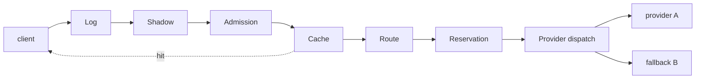

# Design

How Relay is built and why. For running it, see [self-hosting.md](self-hosting.md); for what happens when things break, [failure-modes.md](failure-modes.md).

## What it is

An OpenAI-compatible gateway. Applications talk to Relay as if it were OpenAI; Relay talks to the real providers (Groq, OpenRouter, Anthropic, Gemini, or anything OpenAI-compatible). It does three jobs: **reliability** (retries, deadlines, circuit breakers, fallback), **cost control** (budgets, rate limits, a cache, a router that sends easy requests to cheap models), and **evidence**: it measures whether its own cheap-model and fallback decisions are good, instead of assuming.

It is one stateless Python service. Durable state is in Postgres (keys, request logs, route cards, policy versions) and Redis (rate limits, budgets, provider pauses shared by every gateway). Several gateways can run behind a load balancer.

## The request path

Every stage implements one small protocol: `process(ctx)` returns *continue*, *short-circuit* (a cache hit) or *reject*, and `finalize(ctx, outcome)` runs once when the request ends, **whatever way it ends** (success, error, a client that disconnects, a stream that breaks). All cleanup lives in `finalize`, which is how Relay guarantees that every money reservation is settled or released and no concurrency slot leaks. Stages talk only through one mutable `RequestContext`, so the data flow between them is explicit and testable: build a context, run one stage, assert on it.

| Stage | Job |
|---|---|
| **Log** | Starts the request record. Its `finalize` runs last and writes one row (and the metrics and trace attributes) from the finished context, through a bounded queue: logging is never on the request path |
| **Shadow** | After a successful answer, for tenants that opted in, may start a background comparison for the evidence engine |
| **Admission** | Request-count limits (tenant rpm, per-address rpm), then a concurrency slot, waiting in a priority queue if needed |
| **Cache** | Exact and semantic lookup; a hit answers without routing, a reservation or a provider call |
| **Route** | Chooses the model: the router for `relay/auto`, the alias for the others |
| **Reservation** | Now the model is known, so the price is: holds tokens and money for the worst case across the fallback graph |
| **Provider** | The dispatcher: the only code that retries or falls back |

Why two admission steps: the price depends on the model, and the model is not known until routing has run. Before routing, Relay can only count requests; after, it can hold money.

## Compatibility

Requests and responses follow OpenAI's chat-completions format, validated into an internal schema. Unsupported parameters (tools, `n > 1`, response formats) are **refused by name** rather than ignored. Dropping `tools` silently would return plain text to a client that expected a tool call. Errors use OpenAI's error envelope so SDKs raise their usual typed exceptions. The OpenAI SDK is run against Relay in the test suite, streaming included.

## Streaming

A stream commits at its first content chunk: until then the dispatcher can still fall back to another model; after it, **never**. Switching models mid-answer would splice two models' text. A failure after the first byte ends the stream with an error event and no `[DONE]`. The pipeline's `finalize` is owned by the streaming response, so settlement happens when the stream ends, including when a client disconnects.

## Providers and errors

Each provider has an adapter that speaks its wire format and nothing else. Adapters raise a `ProviderError` carrying an `ErrorClass` in Relay's vocabulary (`rate_limited`, `overloaded`, `timeout`, `context_length_exceeded`, ...), so nothing above the adapter parses a provider's error body. What Relay *does* about each class (retry, fall back, count toward the breaker) is one table in `relay/reliability/policy.py`. What the client is *told* is a separate, deliberate mapping, not a pass-through.

## Reliability

`relay/reliability/dispatch.py` is the only code that retries or falls back. Per request it builds a candidate list (the primary, then fallbacks breadth-first, filtered by the tenant's policy and `allowed_providers`) and walks it: skip checks first (paused, breaker open, no time left), then the call; on failure it records the result, retries once if allowed, and otherwise moves on, finally giving up with the right error.

- **One retry owner.** Clients' SDKs are told not to retry (`x-should-retry: false`), so one request is never multiplied by two layers of retry.
- **Deadlines** are fixed when the request arrives, per tenant and priority, and bound every wait. They stop applying at a stream's first byte.
- **Retry budget.** Retries are capped at a share of recent traffic, so an outage cannot become a retry storm.
- **Circuit breakers** per (provider, model), per gateway: open on a failure ratio, close through a few probes.
- **Fallback edges have states** (`safe`, `undecided`, `unsafe`) that decide whether a *strict* tenant may use them. With no evidence nothing is known to be safe, so by default Relay refuses rather than silently degrading.

## Admission, money and priority

Rate limits are token buckets in Redis, each operation one atomic script; a gateway that cannot reach Redis falls back to in-process limits. **Budgets** work by reservation: before a request runs, Relay holds the worst-case cost (prompt estimate plus the full output cap, at the price of the most expensive model it might fall back to) and refuses if the hold would pass the budget; when the request ends it settles to the real cost and releases the rest. The invariant (committed plus held never exceeds the limit) is checked and applied in one atomic step, and is tested with property-based tests over thousands of generated sequences, including crashed gateways whose holds only expire by themselves. Money is integer nano-dollars; there are no floats near a budget. A daily tenant budget and an optional all-tenant ceiling are both held, together or not at all.

Concurrency uses a priority queue with weighted fair queuing: interactive traffic is served first, and batch is never starved.

## Cache

Two layers, after admission (so a hit still counts toward limits) and before routing (so a hit costs no routing or provider call). The *exact* layer is Redis, keyed by tenant, alias, normalized messages and every output-affecting parameter. The *semantic* layer is Postgres with pgvector: a hit needs cosine similarity above a **measured** threshold, a stored answer short enough for the request, and matching numbers and names (a lexical guard against "capital of France" matching "capital of Spain"). Caching is off until a tenant opts in, only for repeatable requests (temperature 0), and stores embeddings and answers, never prompts. Any failure is a miss.

## Router

For `relay/auto`, a small logistic regression over a prompt embedding and a few scalar features estimates the probability that the cheap model's answer is win-or-tie against the strong one's; above the threshold the request goes to the cheap model. Training is offline (scikit-learn); serving is numpy only, from a validated JSON artifact (not a pickle). The threshold is chosen on a validation split as the most aggressive one whose confidence lower bound on quality is at least 0.95, and is gated in CI. A missing artifact, a mismatched model or an embedder that is too slow all route to the strong model: failure is always quality-safe. The router's score is logged for every routed request.

## Evidence

Judged pairs in, decisions out, never on the request path.

- A **shadow stage** samples a share of traffic from tenants that opted in, makes one extra model call through the same dispatcher (so breakers and limits apply), has a **judge** model decide whether the cheap answer is materially worse, and stores the pair. A daily dollar cap bounds the spend.
- A **worker** turns pairs into **route cards**: for each comparison, an estimate of the rate at which the cheap answer is as good or better, with a confidence interval. Judges make mistakes, so the estimate is **corrected using a small set of human labels** (prediction-powered inference), which keeps the interval honest even when the judge is biased. Decisions are made only at pre-registered looks, with the error rate split across them, so checking repeatedly does not inflate false alarms.
- A judge is trusted only if it **agrees with human labels** (Cohen's κ ≥ 0.6 and loss recall ≥ 0.7). The repository measures this on public human-labeled datasets; see [results.md](results.md).
- Cards drive actions: an `unsafe` card closes a fallback edge or rolls back a canary. Promotion is only ever *recommended*, never automatic.

## Policy bundles

Policy (routers and thresholds, fallback graphs, cache parameters, evidence settings) is versioned separately from plumbing (providers, prices, tenants). A bundle is immutable and content-hashed; applying one re-runs the full validation. One pointer says which is active and which is a candidate, in **shadow** mode (the candidate's decisions are logged, never applied) or **canary** (a percentage of traffic is served by it, sticky per session). Every change is one transaction with an audit row; gateways poll the pointer and swap an immutable snapshot atomically, keeping the last-known-good one if a new one fails to build. A request reads policy from one snapshot, so a swap mid-request cannot mix two policies.

## Observability

One request id appears in the response header, every log line, the trace and the log row. Traces are hand-written spans (request, auth, one per stage, one per upstream attempt with the provider, model, hop and error class) exported over OTLP in a background thread that drops when full. Metrics are recorded once per request from the finished context, with labels restricted to a fixed allowlist (a test enforces it: a request id as a label would create a time series per request). A provisioned Grafana dashboard shows traffic, latency, cost saved against always-strong, cache hit rate, per-provider latency, fallbacks and breaker state.

## Security and privacy

- API keys are stored as HMAC-SHA256 hashes with a server secret. Keys are 256-bit random, so a deliberately fast hash is right, and lookup is an index hit with no per-character comparison to time.
- A tenant's `allowed_providers` is a privacy rule as much as a routing one: it covers primary, fallback, shadow and judge calls alike.
- Request logs hold metadata, never prompts. Prompt text is stored only for tenants that ask for `full` logging, only for evidence, and deleted after their retention period (including the judge's written reason, which can quote the prompt).
- Public-facing limits: request body size, messages, output tokens, per-address rate, and an all-tenant spend ceiling.
- Judged content is untrusted: prompts and answers go to the judge inside delimiters with a per-call random nonce.

## Testing

The suite is specification, not decoration: a failing test means fix the code. Property-based tests cover money (no sequence of reserves, settles, crashes and clock jumps exceeds a limit). The provider contract suite runs the same assertions against a mock, a simulator and recorded wire formats. Chaos tests inject outages, latency spikes, rate-limit storms and mid-stream drops into a seeded provider simulator and compare Relay with a naive retrying client. Evaluations (cache, router, evidence, judge calibration) are frozen, seeded and gated in CI, and `make reproduce` regenerates every number the documentation cites.
